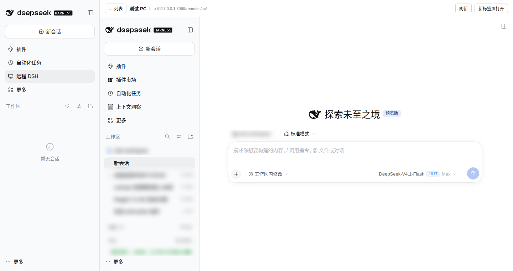

# dsh-remote

**在你每天访问的那台 dsh 里，直接操作另一台机器上的 dsh。**

一个 [DeepSeek Harness](https://github.com/deepseek-ai/deepseek-harness) 插件：把另一台机器上运行的 `dsh web` 挂进当前 dsh 的侧边栏，点一下就在面板里得到**完整的原界面**——会话列表、对话、终端、文件都在，不是截图、不是转发。

```
你的浏览器 ──https──► 宿主机 dsh ──插件反代──► 127.0.0.1:18081
                                                    ▲
                                     ssh -R 反向隧道（被远程机器主动连出）
                                                    │
                                            被远程的 dsh :3081
```

典型用法：服务器上跑 dsh（你通过域名访问它），PC 上也跑 dsh（但没有公网 IP）。插件让服务器 dsh 的侧边栏里出现「远程 DSH」，选中就进入 PC 上的那个 dsh。

## 特性

- **两端都是同一条命令**：`dsh plugin --profile web add "github:GitHub22520/dsh-remote"`，不用克隆仓库、不用拷贝脚本。
- **同一份插件，两种角色**：`remotes:` 是宿主机角色（把别人的 dsh 挂进来），`agent:` 是被远程机器角色（把隧道连出去、把令牌发过来）。
- **PC 不需要公网 IP**：只要被远程的机器能主动 SSH 连到宿主机，反向隧道把它的端口发布到宿主机回环地址。
- **令牌永不进 URL**：令牌由 agent 写进宿主机的文件，代理在服务端完成换取，浏览器只拿到远端自己的会话 cookie。
- **两个实例互不打架**：代理自带 cookie jar 并改写上游 `Host`/`Origin`，两台 dsh 在同一个 origin 下不会互相顶掉登录态；iframe 里的 `localStorage` 自动加前缀。
- **默认安全**：反代路由要求宿主 dsh 已登录（外加 nginx 门户那一层），隧道只绑 `127.0.0.1`，逐跳头/转发头不透传。



<sub>左侧是宿主机 dsh 的侧边栏（多了「远程 DSH」），中间整块面板里跑的是另一台机器上的 dsh（截图中的会话名等已模糊处理）。</sub>

## 快速开始

两步，分别在不同的机器上执行。下文中：

- **宿主机**＝你通过浏览器/域名访问的那台（把别人的 dsh 挂进来）；
- **被远程机器**＝要远程过去的那台（例如你的 PC）。

### 1. 宿主机：装插件 + 一条配置

```bash
dsh plugin --profile web add "github:GitHub22520/dsh-remote"
```

编辑 `~/.dsh/profiles/web/cordis.patch.yml`，在顶层数组末尾追加：

```yaml
- id: dsh-remote
  config:
    remotes:
      - id: pc                     # 路径段与面板标识
        label: 我的 PC              # 面板里显示的名字
        target: http://127.0.0.1:18081   # 隧道在宿主机回环上的端口
```

`tokenFile` 默认是 `~/.dsh/remotes/<id>.token`，正好是 agent 默认发布的位置，通常不用写。

重启宿主机 dsh（或等 HMR 热加载）：

```bash
sudo systemctl restart dsh-web    # 换成本机实际的启动方式
```

### 2. 被远程机器：同样装插件，换成 agent 配置

```bash
dsh plugin --profile web add "github:GitHub22520/dsh-remote"
```

```yaml
- id: dsh-remote
  config:
    agent:
      ssh: you@your-server         # 能免密 SSH 到宿主机的账号
      remotePort: 18081            # 与宿主机 remotes[].target 的端口一致
```

然后重启这台机器上的 dsh。插件会：

- 等自己的 web 端口绑定后，建立 `ssh -N -R 127.0.0.1:18081:127.0.0.1:<本机端口> you@your-server`；
- 把自己进程的启动令牌通过同一条 SSH 写进宿主机的 `~/.dsh/remotes/pc.token`；
- 隧道断开自动重连，重连后重新发布令牌。

前置条件只有一个：**这台机器能免密 SSH 登录宿主机**（`ssh you@your-server true` 不提示密码）。没有免密就用 SSH key 或 `ssh-agent`。

### 3. 打开

宿主机上打开 dsh → 侧边栏「远程 DSH」→ 卡片显示**在线** → 点「打开」。

## 使用说明

- 面板顶部有「← 列表」「刷新」「新标签页打开」。
- 「新标签页打开」走同一个反代路径，适合多窗口并排或需要完整浏览器快捷键的场景。
- 远端离线时卡片显示红点、按钮置灰；agent 恢复后点「刷新」。
- 面板里的 dsh 是**独立实例**：它有自己的模型、凭据、会话和工作区，和宿主机 dsh 完全隔离。
- 只配了 `agent:` 的机器不会出现这个面板（插件检测到没有远端可挂载时会跳过注册）。

## 安全模型

### 同源，所以只挂自己的机器

被挂载的远端页面和宿主机 dsh **同源**。同源意味着远端页面里的 JS 能以你的身份调用宿主机 dsh 的接口（浏览器会自动带上宿主机那张 HttpOnly 会话 cookie）。所以：

> **只挂载你自己掌控的机器。** 不要挂载别人提供的 dsh 地址。

如果需要「不同源」的强隔离（独立 cookie、独立存储、独立权限边界），把远端放到子域名后面（如 `pc.example.com`）即可——代价是 DNS、证书，以及门户 host-only 登录态不跨子域。

### 已经做了的防护

| 防护 | 说明 |
|---|---|
| 双重鉴权 | 外网先过反向代理/门户，再过宿主机 dsh 的会话校验（`requestRejection`），未登录连远端列表都读不到 |
| 令牌不出服务器 | agent 用 `umask 077` 把 token 写成 0600 文件；代理在服务端代换，URL / 历史 / 日志里都没有 token |
| Cookie 隔离 | 远端 `Set-Cookie` 被代理截获存进 per-remote jar，浏览器只保留宿主机那张票；上游 `Host`/`Origin` 改写为回环 authority，两边签名 cookie 名天然不同 |
| 存储隔离 | 代理在远端首页注入小脚本，给 iframe 内 `localStorage`/`sessionStorage` 的键加 `dsh-remote:<id>:` 前缀 |
| 请求头纪律 | 逐跳头（`connection`/`te`/`trailer`/`transfer-encoding`/`upgrade`）与 `forwarded`/`x-forwarded-*`/`x-real-ip` 丢弃后重建 |
| 路径规整 | 带 `..` 段或 NUL 的路径直接 400 |
| 资源上限 | 每个远端最多缓存 32 条、单条 4 KiB 的 cookie；HTML 重写有 8 MiB 上限 |
| 响应加固 | 转发的响应补 `x-content-type-options: nosniff`、`referrer-policy: no-referrer` |
| 隧道最小暴露 | `ssh -R 127.0.0.1:…` 只发布在宿主机回环，公网扫不到 |

## 配置参考

### 宿主机角色 `remotes`

| 字段 | 默认 | 说明 |
|---|---|---|
| `basePath` | `/remotes` | 挂载前缀（服务器内部路径） |
| `tokenDir` | `~/.dsh/remotes` | 令牌文件目录，文件名 `<id>.token` |
| `remotes[].id` | — | **必填**，路径段 + 面板标识，`[A-Za-z0-9_-]+` |
| `remotes[].label` | 同 `id` | 面板显示名 |
| `remotes[].target` | — | **必填**，`http://host:port`，指向隧道 |
| `remotes[].tokenFile` | `<tokenDir>/<id>.token` | 启动令牌文件 |
| `remotes[].token` | 无 | 直接写死令牌（仅调试） |
| `remotes[].upgradePaths` | `['/api/remote.mux']` | 需要转发的 WebSocket 路径 |

多台机器就是多条 `remotes`，每条一个 `id`、一个隧道端口、一个令牌文件。

### 被远程角色 `agent`

| 字段 | 默认 | 说明 |
|---|---|---|
| `agent.ssh` | — | **必填**，`user@host`，宿主机上的 SSH 账号（需免密） |
| `agent.id` | `pc` | 与宿主机 `remotes[].id` 对应，也决定令牌文件名 |
| `agent.remotePort` | `18081` | 宿主机回环上发布的端口 |
| `agent.tokenPath` | `~/.dsh/remotes/<id>.token` | 令牌写到宿主机的路径（`~` 是宿主机上该用户的家目录） |
| `agent.sshBin` | `ssh` | ssh 可执行文件 |
| `agent.extraArgs` | `[]` | 追加给 ssh 的参数，例如 `['-p','2222']` |

## 排查

| 现象 | 处理 |
|---|---|
| 面板显示「离线」 | 隧道没起。宿主机上 `ss -ltn \| grep 18081` 应能看到监听；被远程机器上 `ps aux \| grep 'ssh -N -R'` 应有进程 |
| 打开后「远端 DSH 尚未就绪」 | 令牌没发布。宿主机上 `ls -l ~/.dsh/remotes/pc.token` 的时间戳应是刚刚；没有文件说明 agent 没连上 |
| 打开后「远端令牌无效」 | 被远程的 dsh 重启过但令牌没更新：确认 agent 仍在运行（它会重发），或手动重启该机器的 dsh |
| 打开后「连不上远端 DSH」 | 隧道在但端口不通：被远程机器的 dsh 是否真的在监听 |
| 页面能开但操作无响应 | WebSocket 升级失败：多为令牌失效，重启被远程机器的 dsh 让 agent 重发令牌 |
| 宿主机侧边栏没有「远程 DSH」 | 没有配置 `remotes`（只有 `agent:` 的机器不显示面板），或插件没加载。自检：`curl -s -o /dev/null -w '%{http_code}\n' http://127.0.0.1:<dsh端口>/remotes/_api/list`，返回 401 说明路由在 |
| `dsh plugin add` 失败 | 确认 `git ls-remote https://github.com/GitHub22520/dsh-remote.git` 能通；pnpm 需要访问 GitHub |
| agent 报 `BatchMode` / `Permission denied` | 免密没配好：`ssh you@your-server true` 必须直接返回 |

## 可选：不装插件，单独跑 agent 脚本

被远程的机器不想动 dsh 的插件配置时，可以直接跑仓库里的 `pc/dsh-remote-agent.mjs`（它做同样的事：起 dsh web、建隧道、发布令牌）：

```bash
# 直接跑（需要先拿到仓库里的这个文件）
node dsh-remote-agent.mjs --ssh you@your-server --remote-port 18081

# 或者用 npx 直接从 GitHub 跑，不用克隆
npx -y github:GitHub22520/dsh-remote --ssh you@your-server --remote-port 18081
```

Windows 用 `pc/start.cmd`（先 `set DSH_REMOTE_SSH=you@your-server`），macOS/Linux 用 `pc/start.sh`。

两种方式二选一：同时跑会和插件 agent 抢同一个远程端口。

## 更新 / 卸载

```bash
# 更新到 main 最新
dsh plugin --profile web add "github:GitHub22520/dsh-remote"
# 重启 dsh

# 卸载
dsh plugin --profile web remove dsh-remote
# 再删掉 cordis.patch.yml 里那条 dsh-remote 配置，重启
```

## 开发与调试

纯 ESM、零依赖：宿主/agent 半边 `lib/index.js`（`node:http` + `node:child_process`），浏览器半边 `lib/client.js`（`window.__ModuleLoader__` + React），**没有构建步骤**，改完重启即生效。

本地起隔离实例调试（不碰生产）：

```bash
export DSH_HOME=$PWD/.test-home
dsh --profile web --dump-config >/dev/null      # 生成模板 profile
dsh plugin --profile web add "$PWD"             # 链接本仓库
# 在该 profile 的 cordis.patch.yml 里写 remotes（或 agent），然后：
dsh web --host 127.0.0.1 --port 3099 --no-open
```

测试 agent 角色不想真的连 SSH 时，把 `agent.sshBin` 指向一个假脚本即可（记录参数、必要时 `exec sleep`）。

目录：

```
lib/index.js              宿主/agent 两个角色：反代、鉴权、cookie jar、HTML 注入、隧道与令牌发布
lib/client.js             浏览器半边：侧边栏入口 + 面板 + iframe
pc/dsh-remote-agent.mjs   可选的独立 agent（不起插件时的等价物）
pc/start.sh / start.cmd   独立 agent 的启动包装
cordis.patch.yml          插件作为 bundle 的 patch 层
install.sh                服务器端便捷安装（可选）
```

要求：dsh `0.2.x`（`ctx.webServer` / `ctx.connection` / `ctx.slots` 接口），Node.js ≥ 20。

## License

[MIT](LICENSE)

---

<sub>English: `dsh-remote` mounts a remote `dsh web` instance (e.g. your home PC reached through an `ssh -R` tunnel) into the local web GUI as a sidebar panel. One plugin, two config roles: `remotes:` on the host you browse, `agent:` on the machine being reached (it dials out and publishes its launch token). Install both ends with `dsh plugin --profile web add "github:GitHub22520/dsh-remote"`.</sub>
